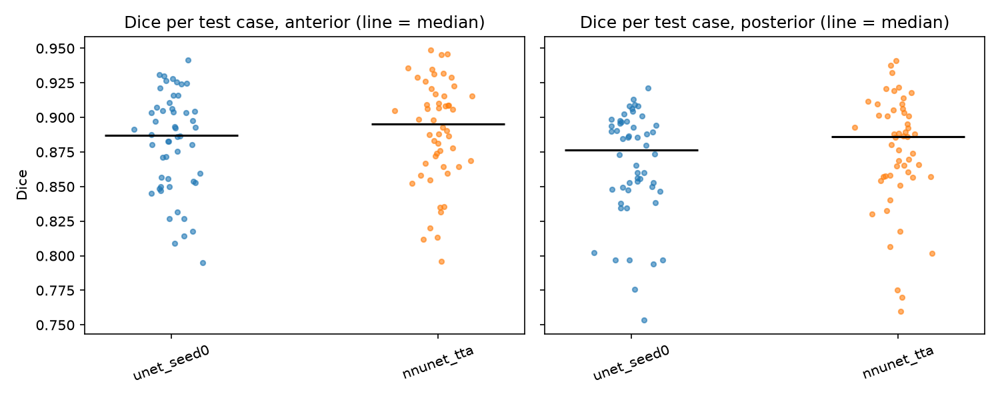
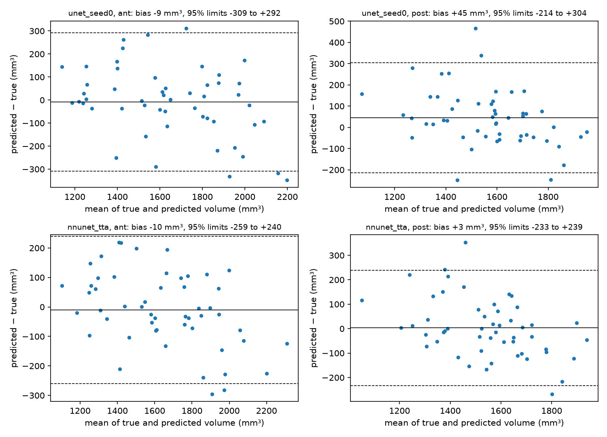
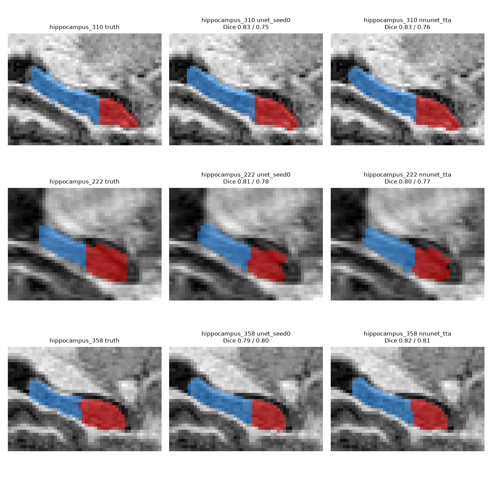

# NeuroSeg-AI v0.1

Hippocampus segmentation on MSD Task04: a small hand-built MONAI 3D U-Net compared
against nnU-Net v2, scored by the same evaluation code on the same held-out test set.

## 1. Question

Can a small, hand-built MONAI 3D U-Net match nnU-Net v2 on hippocampus segmentation,
when both are scored by my own evaluation code on the same held-out test set?

## 2. Data

Medical Segmentation Decathlon **Task04 Hippocampus** (reference: Vanderbilt University
Medical Center; licence **CC-BY-SA 4.0**). 260 labelled MRI crops, all 1×1×1 mm, oriented
to RAS. Two foreground labels: **1 = anterior**, **2 = posterior** hippocampus.

The imaging data is **not included in this repository** (CC-BY-SA 4.0; images and labels
are never committed here). Download it from the Medical Segmentation Decathlon
(http://medicaldecathlon.com/) and unpack it to `C:\data\msd\Task04_Hippocampus`
(the path the scripts expect; edit `ROOT` in the scripts to change it).

## 3. Split and its limitation

A single fixed split, drawn once with seed 42 (`scripts/make_split.py` →
`splits/split_v1.json`): **166 train / 42 validation / 52 test**. The test set was used
**once**, for the final comparison only. Both models use this identical split (for nnU-Net,
the 208 train+val cases become its custom `splits_final.json` fold and the 52 test cases
are held out of its dataset), so the comparison between the two models is fair.

**Limitation (DECISIONS D2).** Task04 is distributed as pre-cut crops. The full release is
about 390 crops (260 labelled + 130 unlabelled), roughly 195 people × 2 sides, but the scan
origins are wiped, the IDs are interleaved, all crops face one direction, and there are no
intensity "twins". Crops therefore **cannot be grouped back to a person**, so a left and a
right crop from the same person may land on opposite sides of the split. Because both models
share the split this does not bias the comparison, but the **absolute** Dice may be slightly
optimistic relative to a subject-grouped split.

## 4. Methods

| | **MONAI U-Net (this repo)** | **nnU-Net v2** |
|---|---|---|
| Network | MONAI `UNet`, channels 16–32–64–128, strides (2, 2, 2), 2 residual units | `PlainConvUNet`, features 32–64–128–256 (3d_fullres default plan) |
| Parameters | 1,187,766 (1.19 M) | nnU-Net default (not counted here) |
| Loss | DiceCE | nnU-Net default (Dice + CE) |
| Optimiser | Adam, lr 1e-3 | nnU-Net default |
| Batch / patch | batch 8, 32³ random patches | batch 7, patch 40×56×40 (from `plans.json`) |
| Augmentation | left–right flip only (axis 0, p = 0.5) — front–back flipping would swap anterior/posterior | nnU-Net default pipeline |
| Normalisation | per-scan z-score | z-score (per `plans.json`) |
| Schedule | 200 epochs, validate every 5, keep best-on-val checkpoint | `nnUNetTrainer_250epochs`, **FINAL** checkpoint |
| Inference | sliding-window (roi 32³) | sliding window; results reported **with and without TTA** |
| Fold / split | `split_v1.json` | my split as a custom `splits_final.json` fold |
| Hardware | CPU | Tesla T4 GPU |
| Seeds | 0, 1, 2 | single run |
| Train time | 12.8 – 15.8 min/seed (`run_info.json`) | 117.6 min (`nnunet_run_info.json`) |
| Inference time | 0.04 – 0.06 s/case (CPU) | 0.47 s/case (TTA), 0.44 s/case (no TTA) |

The U-Net is trained three times (seeds 0, 1, 2) to measure run-to-run spread. nnU-Net's
3d_fullres plan was read from `results/nnunet_config/plans.json` (patch 40×56×40, batch 7,
`PlainConvUNet`).

## 5. Evaluation

Scoring is done by my own code, `scripts/evaluate.py`:

- **Dice** and **HD95** (95th-percentile Hausdorff distance, in mm — voxels are 1 mm) via
  MONAI, per label; and **signed** and **absolute volume error** (predicted − true, in mm³).
- A **self-test** (`python scripts/evaluate.py --selftest`) checks the metric code on shapes
  with a known answer: identical masks give Dice = 1 and HD95 = 0; a 2-voxel shift gives
  HD95 ≈ 2.00.
- Each prediction is checked to be in the same shape and affine space as its ground truth
  before scoring.

Aggregation and significance:

- Case-level **bootstrap 95% CIs** (B = 5000, `scripts/compare.py`) for every metric.
- **Paired** bootstrap differences against the reference model, on the same cases.
- The comparison follows the **pre-registered rule D3** (written before the nnU-Net results
  were seen; see `DECISIONS.md`).

## 6. Results

### Main table — mean [95% bootstrap CI] over the 52 test cases

Source: `results/comparison.csv` (reproducible from the metrics CSVs with `compare.py`).

| Model | Dice ant | Dice post | HD95 ant (mm) | HD95 post (mm) | Abs vol err ant (%) | Abs vol err post (%) | Compute |
|---|---|---|---|---|---|---|---|
| **unet_mean** | 0.880 [0.870, 0.889] | 0.866 [0.856, 0.876] | 1.508 [1.369, 1.670] | 1.562 [1.412, 1.726] | 7.403 [6.000, 8.946] | 7.105 [5.353, 9.061] | CPU; 3× ~12.8–15.8 min; 1.19 M params |
| unet_seed0 | 0.881 [0.871, 0.891] | 0.866 [0.855, 0.876] | 1.472 [1.316, 1.646] | 1.530 [1.360, 1.708] | 6.871 [5.296, 8.561] | 7.111 [5.275, 9.192] | CPU; 14.9 min |
| unet_seed1 | 0.882 [0.871, 0.892] | 0.867 [0.857, 0.876] | 1.416 [1.288, 1.559] | 1.588 [1.441, 1.748] | 7.779 [6.423, 9.223] | 7.067 [5.277, 8.966] | CPU; 15.8 min |
| unet_seed2 | 0.876 [0.866, 0.885] | 0.866 [0.856, 0.876] | 1.636 [1.412, 1.935] | 1.566 [1.403, 1.738] | 7.557 [6.070, 9.142] | 7.137 [5.198, 9.209] | CPU; 12.8 min |
| **nnunet_tta** | 0.890 [0.879, 0.899] | 0.875 [0.863, 0.886] | 1.392 [1.259, 1.529] | 1.432 [1.284, 1.593] | 6.196 [4.962, 7.474] | 6.093 [4.606, 7.651] | T4 GPU; 117.6 min; 0.47 s/case |
| nnunet_notta | 0.884 [0.873, 0.894] | 0.869 [0.858, 0.880] | 1.412 [1.280, 1.557] | 1.473 [1.324, 1.628] | 6.288 [5.011, 7.607] | 6.632 [5.086, 8.379] | T4 GPU; 117.6 min; 0.44 s/case |

### Paired differences vs `unet_mean` (same cases)

From `scripts/compare.py` (B = 5000). A difference is flagged real only if its CI excludes 0.

| Comparison | Metric | Difference [95% CI] | CI excludes 0? |
|---|---|---|---|
| nnunet_tta − unet_mean | Dice ant | +0.0098 [+0.0046, +0.0146] | yes |
| nnunet_tta − unet_mean | Dice post | +0.0088 [+0.0044, +0.0131] | yes |
| nnunet_tta − unet_mean | HD95 ant | −0.12 [−0.20, −0.04] mm | yes |
| nnunet_tta − unet_mean | HD95 post | −0.13 [−0.22, −0.04] mm | yes |
| nnunet_notta − unet_mean | Dice ant | +0.0042 [−0.0011, +0.0094] | no |
| nnunet_notta − unet_mean | Dice post | +0.0030 [−0.0013, +0.0073] | no |

### Verdict under D3

- **nnU-Net with TTA is the better model** on this test set: it is ahead by about **1 Dice
  point** on both labels and the paired CIs exclude 0 (passes D3 condition (a)). But the win
  is **narrow** — the lower CI bounds (about +0.005) sit roughly at the seed-to-seed spread
  (~0.006 Dice), so it only just clears D3 condition (b).
- **Without TTA the Dice difference fails D3**: both CIs include 0. So roughly **half** of
  nnU-Net's Dice advantage comes from test-time augmentation, which my U-Net does not use.
- The **HD95 gains are about 0.1 mm** on 1 mm voxels (sub-voxel), and for the anterior label
  they are within the U-Net's own seed-to-seed HD95 spread (~0.22 mm across seeds). I do
  **not** count the HD95 differences as a meaningful win.

### Volume agreement — `figures/bland_altman.png`

Bias and 95% limits of agreement (predicted − true, mm³), read from the figure:

| | Anterior | Posterior |
|---|---|---|
| unet_seed0 | bias −9, limits −309 to +292 | bias **+45**, limits −214 to +304 |
| nnunet_tta | bias −10, limits −259 to +240 | bias **+3**, limits −233 to +239 |

The U-Net has a small **positive posterior bias (+45 mm³)** where nnU-Net is near zero
(+3 mm³), and nnU-Net's limits of agreement are narrower (roughly ±250 vs ±300 mm³). In the
anterior panels both models over-estimate small volumes and under-estimate large ones
(proportional bias) — since it appears for both models, this is likely a property of the task
rather than of one model.

### Whole-hippocampus check — D4 (post-hoc)

With the two labels merged into a single hippocampus mask (`scripts/whole_dice.py`):

| | Mean Dice | Min Dice |
|---|---|---|
| unet_seed0 | 0.896 | 0.813 |
| nnunet_tta | 0.904 | 0.814 |

I expected the anterior/posterior boundary to account for most of the error; merging the
labels shows it does **not** — the whole-mask Dice is only a little higher than the per-label
Dice, and the minimum is essentially the same for both models. Most error therefore lies on
the **outer surface**, and the same hard cases are hard for both models. (These numbers are
`whole_dice.py` stdout and are the one result not persisted to a committed file — see
"numbers" note below.)

### Figures

- `figures/dice_per_case.png` — Dice for every test case, anterior and posterior, one column
  per model (horizontal line = median). Shows the spread behind the mean, and that the models
  overlap heavily case by case.
- `figures/bland_altman.png` — predicted vs true volume agreement per label and model (see table above).
- `figures/worst_cases.png` — the three cases where `unet_seed0` scores worst, with ground
  truth and each model's prediction overlaid on the MRI; the same cases are difficult for nnU-Net too.





## 7. What I learned / limitations

- **Single split, single fold, no external test set.** Everything rests on one 52-case test
  set; results could shift on another split.
- **Subject grouping is unverifiable (D2).** Absolute Dice may be slightly optimistic.
- **Checkpoint mismatch.** The U-Net is scored at its best-on-validation checkpoint, nnU-Net
  at its FINAL checkpoint. If anything this favours the U-Net, so it does not weaken nnU-Net's result.
- **GPU vs CPU timings are not like-for-like.** The U-Net ran on CPU, nnU-Net on a T4 GPU;
  the minute counts describe the two setups, not a controlled speed comparison.
- **Multiple comparisons.** About 20 paired tests were run; a few "CI excludes 0" hits are
  expected by chance. The seed-vs-mean rows show this — some U-Net seeds also produce
  CI-excludes-0 HD95/Dice differences against `unet_mean` that are just noise.
- **Pre-cut crops.** The organisers pre-cut the hippocampus region, so this is **not** a
  full-brain pipeline — localisation is already done.
- **Possible next step:** add flip TTA to the U-Net (this would be post-hoc, since TTA is where
  about half of nnU-Net's Dice advantage comes from).

## 8. How to reproduce

```bash
# 1. Environment
conda create -n neuroseg python=3.10 -y
conda activate neuroseg
pip install -r requirements.txt   # then pin versions from your env if needed

# 2. Data: download MSD Task04 Hippocampus from http://medicaldecathlon.com/
#    and unpack to C:\data\msd\Task04_Hippocampus (or edit ROOT in the scripts).

# 3. Split (writes splits/split_v1.json)
python scripts/make_split.py

# 4. Train the MONAI U-Net, three seeds
python scripts/train_unet.py --seed 0
python scripts/train_unet.py --seed 1
python scripts/train_unet.py --seed 2

# 5. nnU-Net v2 (run on Kaggle / a GPU box). Using my split as a custom fold:
#    nnUNetv2_plan_and_preprocess -d 004 --verify_dataset_integrity
#    # place my split_v1 train+val as splits_final.json for Dataset004
#    nnUNetv2_train 004 3d_fullres 0 -tr nnUNetTrainer_250epochs
#    nnUNetv2_predict -i <test_imgs> -o results/preds_tta    -d 004 -c 3d_fullres -f 0 -tr nnUNetTrainer_250epochs --save_probabilities
#    nnUNetv2_predict -i <test_imgs> -o results/preds_notta  -d 004 -c 3d_fullres -f 0 -tr nnUNetTrainer_250epochs --disable_tta

# 6. Check the metric code
python scripts/evaluate.py --selftest

# 7. Score every prediction folder -> results/metrics/<tag>.csv
python scripts/evaluate.py results/unet_seed0/preds unet_seed0
python scripts/evaluate.py results/unet_seed1/preds unet_seed1
python scripts/evaluate.py results/unet_seed2/preds unet_seed2
python scripts/evaluate.py results/preds_tta        nnunet_tta
python scripts/evaluate.py results/preds_notta      nnunet_notta

# 8. Comparison table + paired differences -> results/comparison.csv
python scripts/compare.py unet_mean unet_seed0 unet_seed1 unet_seed2 nnunet_tta nnunet_notta

# 9. Figures (first model picks the worst cases)
python scripts/figures.py unet_seed0 nnunet_tta

# 10. Post-hoc whole-hippocampus Dice (D4)
python scripts/whole_dice.py
```

---

**A note on the numbers.** Every figure and table above is traceable to a committed file:
`results/comparison.csv`, `results/metrics/*.csv`, `results/*/run_info.json`,
`results/*/history.json`, `results/nnunet_run_info.json`, `results/nnunet_config/plans.json`,
and the committed `figures/*.png`. The two exceptions are the whole-hippocampus Dice (§6, D4)
and the self-test values (§5), which are stdout from `whole_dice.py` and
`evaluate.py --selftest` and are not written to a file — reproduce them with the commands above.
